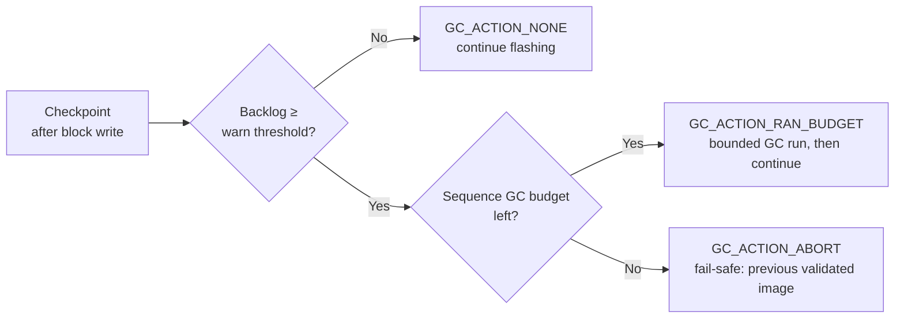

# ADR-0001: Budget GC During Flash Sequences

## Context

A flash sequence (boot manager → flash bootloader → application, block by block)
writes a progress marker to NVM after every block. Each write is a potential GC
trigger. Blanket-suppressing GC for the whole sequence lets the backlog grow
unbounded; letting GC run fully uncontrolled risks an unbounded stall inside the
flash sequence's own timing budget. Neither extreme is acceptable.

## Is this a Platform SW concern?

| Criterion | Assessment |
|---|---|
| Needed by more than one product/derivative? | Yes — every derivative on this NVM/FEE stack flashes in blocks |
| Hides vendor/MCAL specifics behind a stable interface? | Yes — `Gc_GetBacklogPercent` / `Gc_RunBounded` abstract the FEE stack |
| Carries product-specific business logic? | No — thresholds are the only per-product knob |
| **→ Conclusion** | **Platform SW component** — one reusable checkpoint hook, not per-product ad hoc logic |

## Decision

Give GC a bounded budget, checked at a checkpoint between block writes, instead of
blanket suppression or fully uncontrolled GC:



## Implementation contract

```yaml
component: GcBudgetController   # Platform SW, reusable across products

interface:
  GcBudget_OnCheckpoint():
    returns: [GC_ACTION_NONE, GC_ACTION_RAN_BUDGET, GC_ACTION_ABORT]
    called: "after every block's progress-marker write, same point every block"
    pre: "never called mid erase/write"
    post: "on ABORT, previously validated image stays active; caller must stop flashing"
  Gc_GetBacklogPercent(): uint8          # 0-100, provided by the NVM/FEE stack
  Gc_RunBounded(max_ms): bool            # provided by the NVM/FEE stack

config:   # calibration_required: true for all three -- no shipped defaults
  GC_BACKLOG_WARN_THRESHOLD_PERCENT: uint8    # depends on sector size + measured GC cost
  GC_BUDGET_MS_PER_CHECKPOINT: uint32         # must fit inside the existing flash-sequence timing budget
  GC_MAX_BUDGET_MS_TOTAL: uint32              # cumulative cap per sequence

acceptance_criteria:
  - "backlog < warn_threshold -> NONE, no added latency"
  - "backlog >= warn_threshold, budget left -> RAN_BUDGET, bounded by GC_BUDGET_MS_PER_CHECKPOINT"
  - "budget exhausted, backlog still high -> ABORT, previous validated image stays active"
  - "power loss during a bounded run -> FEE stack recovers to a consistent state on reboot (dependency, not implemented here)"
```

## Consequences

- **+** Bounded worst-case latency per flash sequence; one reusable platform
  component instead of per-product ad hoc GC handling.
- **−** Three tunables need real calibration per target, not a guessed default.
  Assumes the FEE stack can expose a backlog query and a bounded GC run — verify
  against the actual MCAL/FEE supplier before relying on it.

## Related

- Post: [`_posts/2026-08-29-garbage-collection-friend-or-enemy.md`](../_posts/2026-08-29-garbage-collection-friend-or-enemy.md) ("Garbage Collection — friend or enemy")
- Depends on: the NVM/FEE stack's own atomicity guarantees across power loss — out of scope here
